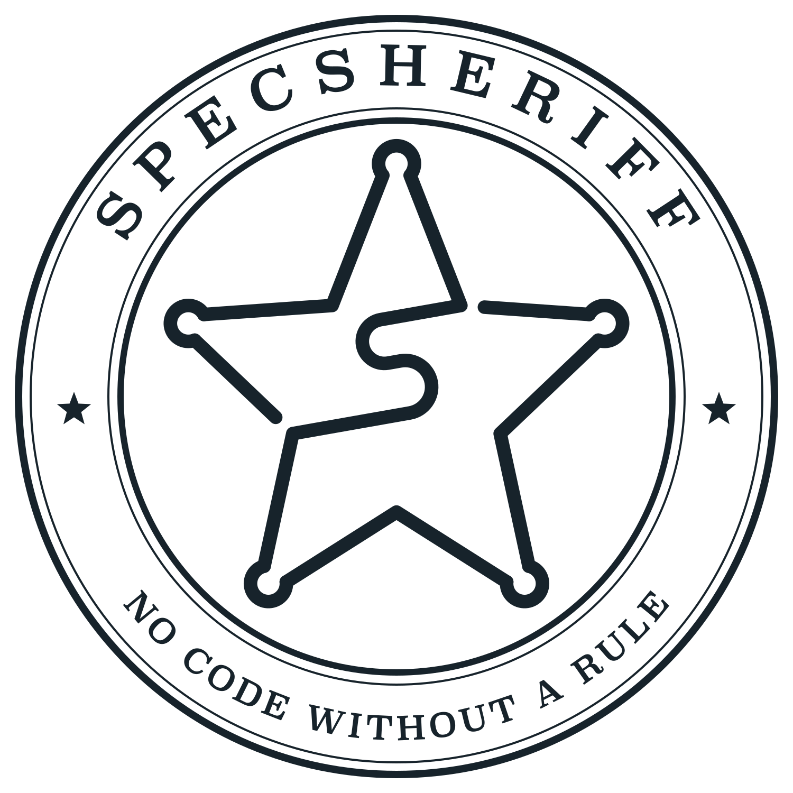

  <picture>
    <source media="(prefers-color-scheme: dark)" srcset="brand/exports/coin-dark.svg">
    
  </picture>

# SpecSheriff

**No code ships without a rule that warrants it.**

SpecSheriff is a method of spec-anchored development, the tools that hold a project to it, and a
worked example of it. The specification is a set of small rule nodes, each with a permanent
identifier, a reason held apart from the requirement, and a status that says whether the
specification's owner has read the wording. Every symbol in the code names the rule it implements,
every test declares the rule it verifies, and every commit is checked against the rules it claims to
serve — by deterministic checks, and by an independent reviewer that sees only the change and the
text of those rules.

## Three parts

- **The theory** — what the method is and why: [the method on one page](docs/README.md), [the
  principles](docs/principles.md), [what already exists and where this method
  differs](docs/research/landscape.md), [the decisions taken so far](docs/design-log.md), and the
  SpecSheriff guidelines themselves as rule nodes in
  [`specs/_guidelines/`](specs/_guidelines/): the base in `spec.json`, and in `tools.json` the
  appendix saying how the tools carry it out.
- **The skills** — what a practitioner installs: the plugin for Claude Code in
  [`skills/claude-code`](skills/claude-code), listed by the marketplace of this repository and
  carrying the skills, the SpecSheriff guidelines and the SpecSheriff tools (the command `sheriff`,
  built from [`skills/specsheriff`](skills/specsheriff)), and the tools' plugin for pytest in
  [`skills/pytest-specsheriff`](skills/pytest-specsheriff). Codex CLI comes next.
- **The worked example** — a saloon in a frontier town, set up the way any project is. It comes after
  the plugin.

## Status

Work in progress. The guidelines are confirmed by their owner, the tools hold this repository to
them, and the plugin for Claude Code carries both; the worked example is being built. Nothing here is
released yet.

## License

What a project installs — the tools, the skills, the guidelines and the worked example — is licensed
under the [Apache License 2.0](LICENSE). What is read and shared — everything under `docs/`, the
articles and the infographics — is licensed under
[Creative Commons Attribution 4.0 International](LICENSE-docs): reuse it freely, naming SpecSheriff
and linking here. The mark in [`brand/`](brand/) is under neither: [how it may be used](brand/README.md).
