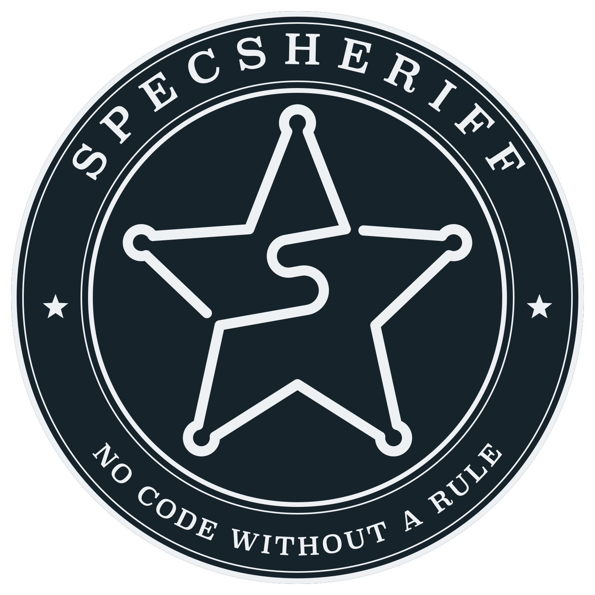

<p align="center">
  
</p>

# SpecSheriff

**No code ships without a rule that warrants it.**

SpecSheriff is a spec-anchored development method and the tools that enforce it: code is written only
against approved rules of the specification, and every commit is checked against them.

## Three parts

- **The theory** — what the method is and why: [the method on one page](docs/README.md), [the
  principles](docs/principles.md), [what already exists and where this method
  differs](docs/research/landscape.md), and the
  SpecSheriff guidelines themselves as rule nodes in
  [`specs/_guidelines/`](specs/_guidelines/): the base in `spec.json`, and in `tools.json` the
  appendix saying how the tools carry it out.
- **The skills** — what a practitioner installs: the plugin for Claude Code in
  [`skills/claude-code`](skills/claude-code) and the plugin for Codex CLI in
  [`skills/codex`](skills/codex), listed by the marketplace of this repository, each installed and
  updated by its own agent and carrying the skills, the SpecSheriff guidelines and the SpecSheriff
  tools (the command `sheriff`, built from [`skills/tools`](skills/tools)); and the tools' plugin for
  pytest in [`skills/pytest-specsheriff`](skills/pytest-specsheriff).
- **The worked example** — [the saloon](https://github.com/non4me/specsheriff-saloon) of a frontier
  town, in a repository of its own, set up the way any project is: its history shows every rule
  approved by its owner, every test written before its code, and a recorded run in which the
  reviewer refuses a commit that every test and every other check let through.

## Using it

```sh
claude plugin marketplace add non4me/SpecSheriff#release
claude plugin install specsheriff@specsheriff-marketplace
```

Then ask the agent, in your repository, to set it up for SpecSheriff. [The
guide](skills/claude-code/README.md) says when to take each skill, what it asks, what it changes, and
what each refusal of the checks means.

## Status

The release 0.6.0 carries the plugins for Claude Code and for Codex CLI: the guidelines are approved
by their owner, and the tools hold this repository to them. The worked example, the saloon, is built and published.

## License

What a project installs — the tools, the skills, the guidelines and the worked example — is licensed
under the [Apache License 2.0](LICENSE). What is read and shared — everything under `docs/` and
`_promo/`, the articles and the pictures among it — is licensed under
[Creative Commons Attribution 4.0 International](LICENSE-docs): reuse it freely, naming SpecSheriff
and linking here. The mark in [`_promo/brand/`](_promo/brand/) is under neither: [how it may be used](_promo/brand/README.md).
