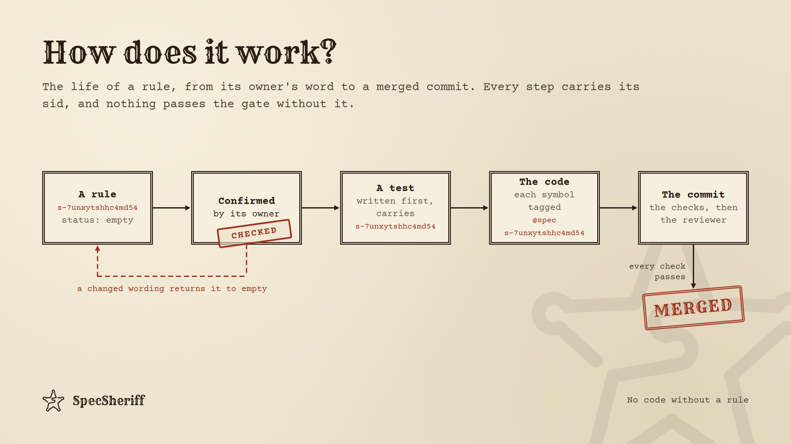
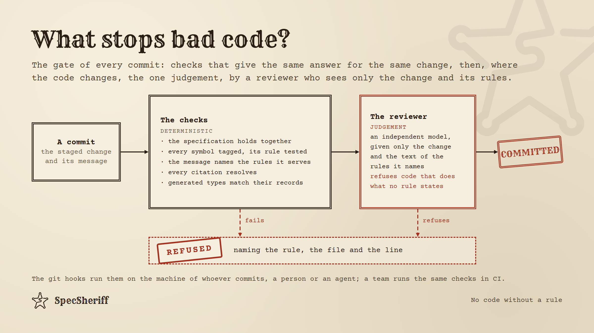
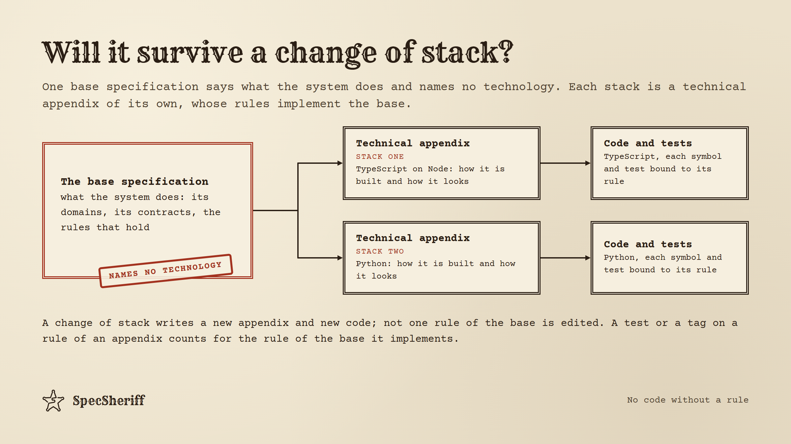
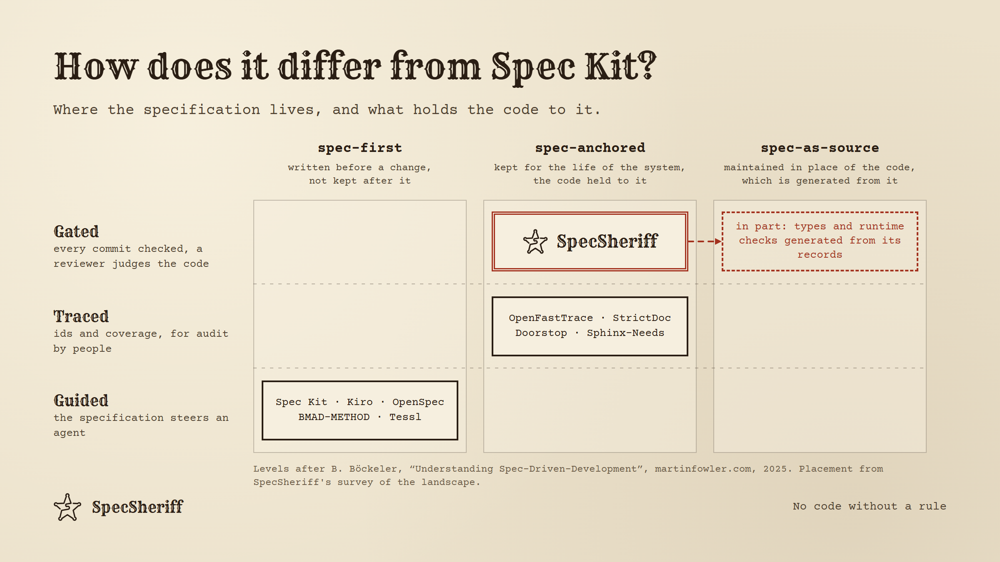

# No code without a rule

## Two ways to lose

There are two ways to work with code today, and each of them loses something.

The first is vibe coding. You say what you want, an agent writes it, and you accept what runs. It is
fast. But after a few weeks you no longer understand your own application. You cannot say which
requirement a given line serves. A decision you took a month ago is undone in passing by a
refactoring nobody asked for, and you learn of it from a user. Review cannot keep up with what is
generated, so it turns into skimming. The logic of the system now lives in code that is no longer
yours.

The second is writing the code by hand. It keeps the understanding, at a price. Your attention goes
to the code — the syntax, the plumbing, the hundred small decisions of an implementation — rather
than to what the system must do. It is slow. And why the code is the way it is lives in your head,
or in documents that nobody keeps up to date.

I wanted a third way: the understanding and the control of hand-written code, at the speed of
agents. SpecSheriff is my attempt at it.

## The idea

Like spec-driven development in general, SpecSheriff puts the specification first. The developer's
attention stays there: the specification is where the logic of the system is written, read and
changed, and so it is where that logic is understood and controlled. The agent writes the code, held
hard by skills that tell it how to work and by checks that do not negotiate.

None of the parts is new. Permanent identifiers for requirements, linked to code and tests, have
been used in regulated industries for decades. A specification written before the code to guide an
agent is what Spec Kit and Kiro do. A sign-off tied to the exact text of a specification, going
stale when the text changes, and a deterministic gate, exist in tools such as SpecGate. A model judging a change against its ticket
exists in Qodo, as advice. What I have not found anywhere is all of them held together, so that each
covers the gap the others leave. That is the method.

## The principles

### The specification first, in one direction

Every change runs the same way: the rule first, then the test of the rule, then the code that makes
the test pass. Never the reverse. Wanting the code to behave differently is a reason to change a
rule, not to change the code and update the documents later (§s-ef93u6cnbs2sevr,
§s-rah8b37kytb682y).



### Rule, test and code bound by an identifier

The specification here is not a document. It is a set of small rules, each a node with a permanent
identifier, its sid, and with the reason for the rule kept apart from what it requires
(§s-kh8qcd5kxgh9z3j, §s-kag2m9tzdnduxdx, §s-dpe5kcz4eamv39g). Every test declares the sid of the
rule it verifies (§s-rah8b37kytb682y). Every symbol of the code, every function and class, carries a
tag naming the rule it implements (§s-kgbzk2ph9e6jfb4). From any line of code you can reach the rule that warrants it,
and from any rule the code and the tests that carry it out. It also means an agent can be given the
rules that bear on its task rather than the whole specification.

### Nothing unconfirmed is implemented

Anyone may write or change a rule, an agent included. But a rule is implemented only once its owner
has read it and confirmed it. The confirmation is tied to the wording: change what the rule says,
and it waits for its owner again (§s-5ah25f6gy99panq, §s-67vekyup7y8smap, §s-utvqbypzhmgndug). A
change that only states what the owner has already confirmed, or changes no meaning, such as a
renamed term, is confirmed in the owner's name and reported to them. Anyone who finds a confirmed
rule wrong can withdraw its confirmation, and no further change to its code is committed until the
owner looks again. A large specification can name an owner for each domain or section, so that the
people who answer for a part of the system are the ones who confirm its rules.

### Checks that answer the same way every time

Deterministic checks hold the chain together. They run in the agent's harness, at every edit it
makes, where the order of rule, test and code is held too; and in git, at every commit, on the
machine of whoever makes it (§s-83ev4wwesbwnhnp, §s-jau82aq9juv9zzh). A symbol with no tag, code
whose rule has no test yet, code tagged with a rule nobody has confirmed, a commit that does not name
the rules it serves: each is refused, with the reason. The tests of the system run before a commit
is shared. The git hooks hold every machine where the plugin is installed; a team that needs the
gate to hold whatever machine a change came from runs the same checks in CI.

### One judgement, by an independent reviewer

One question is beyond any deterministic check: does the code do only what its rules say? So at
every commit that changes code an independent model is asked. It is given nothing of the session that wrote the code,
only the change and the text of the rules the commit names. If the code does something no named rule
states, or leaves out what one requires, it refuses the commit and names the rule and the line
(§s-nyh9yk22ba6g77q).



### A rule is self-sufficient

Everything that bears on a rule is in its node: its text and its reason, the links it makes to other
rules and theirs to it, the decisions taken on it, the work deferred on it. When a question comes up
a year later, the answer is in the rule, not in a chat history.

### Three documents, changing at three rates

The guidelines say how the specification is kept and implemented, and they hardly change. The base
specification says what the system does, in no technology's terms; it changes only when the business
logic or the system's core functionality does. The
technical appendix says how the system is built, and it changes most often. Change the stack, and
you write a new appendix and new code, not one rule of the base (§s-5x737t9nee4zgaa,
§s-vj7ercem526zd6v).



## What it gives

The logic of the application stays in front of you, readable, and yours. You decide it by writing
and confirming rules, and you see exactly what the agent made of them. The agent does the typing,
fast, and is kept from wandering off: what it writes must carry a rule, pass that rule's test, and
get past a reviewer who reads the change against nothing but its rules.

A team gets requirements traced both ways, decisions that stay decided, owners who confirm what is
theirs, and a review of every commit that changes code, one that does not depend on how much time a
person has that day.

I have worked this way for two months on a project of my own: one engineer with agents, about 1,800
rules and about 3,900 bindings of code to them. The agents did not drift from the rules. A small,
public example shows the gate at work: in the
[saloon's recorded run](https://github.com/non4me/specsheriff-saloon/tree/main/recorded-run) an agent
asked to make service faster stops counting what a regular already owes when it holds a charge to
the limit of their tab, and rewrites the tests its change broke. All 38 tests pass and every deterministic check lets the change through; the
reviewer refuses it, naming the rule on the limit and the line.

## How it differs from Spec Kit

Birgitta Böckeler divides spec-driven development into three levels. Spec-first: a specification
guides one change and is not kept. Spec-anchored: it is kept for the life of the system, and the code
is held to it. Spec-as-source: it is maintained instead of the code, which is generated from it. Most
tools for coding agents are spec-first. SpecSheriff is spec-anchored, with the code held to the
specification mechanically, at every edit and every commit; and spec-as-source in part, since the
types and the runtime checks of data are generated from it.



## What it costs

It is not free. The owner reads and confirms every rule whose meaning changes. Every symbol carries
a tag. The reviewer is a model called at every commit that changes code, paid by whoever commits, at
the model and effort they have chosen. The
tools do the remembering, so that nobody has to keep the rules of the method in their head, but the
reading and the deciding stay with you. That is the point: the work moves from writing code to
deciding what the code must do.

## Try it

SpecSheriff is a plugin for Claude Code and for Codex CLI. For Claude Code:

```
claude plugin marketplace add non4me/SpecSheriff#release
claude plugin install specsheriff@specsheriff-marketplace
```

For Codex CLI:

```
codex plugin marketplace add non4me/SpecSheriff@release
codex plugin add specsheriff@specsheriff-marketplace
```

Then, in a repository, ask the agent to set the project up with the skill `spec-init`: it lays out
the git hooks, the agent's hooks and the specification's first files. To see the method on a whole
project first, clone [the saloon](https://github.com/non4me/specsheriff-saloon), follow one rule from
its text to its tests and code, and replay the recorded run.

Everything is in [the repository](https://github.com/non4me/SpecSheriff): the method on one page, the
principles, the guidelines as rule nodes, and the guide.
